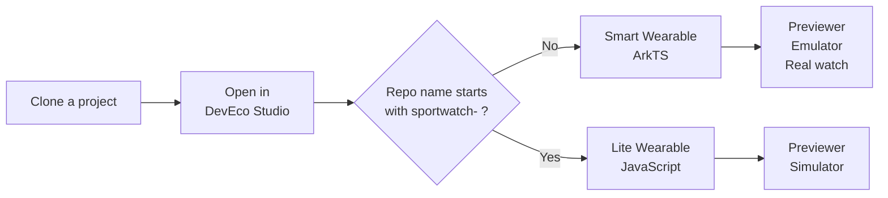

<div align="center">

# Explore in HarmonyOS Wearable

**551 open source projects for Huawei wearable development.**

<p>
  
  
  
  
  
</p>

**[Start here](#-start-here)** &nbsp;·&nbsp; **[Browse projects](#-projects)** &nbsp;·&nbsp; **[Setup guide](docs/GETTING_STARTED.md)** &nbsp;·&nbsp; **[Troubleshooting](docs/TROUBLESHOOTING.md)**

</div>

---

## 🚀 Start here

```bash
git clone https://github.com/Explore-In-HMOS/<project-name>.git
```

1. Install **[DevEco Studio](https://developer.huawei.com/consumer/en/deveco-studio/)** and sign in with your Huawei ID.
2. **File → Open** the cloned folder. Select the project root, not `entry/`.
3. Wait for the dependency sync, then click **Previewer** to see the UI.
4. To run it on a real watch: **[follow the setup guide](docs/GETTING_STARTED.md)**.



| Guide | Covers |
|---|---|
| 📘 [Getting Started](docs/GETTING_STARTED.md) | Accounts, DevEco Studio, signing, running on a real watch, hdc commands |
| 🩺 [Troubleshooting](docs/TROUBLESHOOTING.md) | Sync, build, signing and connection errors, plus FAQ |
| 📖 [HMOS User Guides](https://github.com/Explore-In-HMOS/hmos-user-guides) | In-depth guides such as the Health Service Kit and the Lite Wearable technical guide |

### 🤖 Building with an AI assistant

Install the **[HarmonyOS Wearable Samples skill](skill/hmos-wearable-samples/SKILL.md)** to give Claude, or any assistant that supports skills, a searchable index of all 551 projects. It answers "is there a sample for reading heart rate" with the repository name and URL instead of inventing ArkTS from memory, and it knows the Smart and Lite Wearable platforms are not interchangeable.

```bash
unzip skill/hmos-wearable-samples.skill -d ~/.claude/skills/
```

---

## 📚 Projects

Each project is a standalone repository. Clone only the one you need.

| Category | Count | Platform | Language |
|---|---|---|---|
| [⌚ Sample Applications](#-sample-applications) | **206** | Smart Wearable | ArkTS |
| [🛠️ How-To Projects](#-how-to-projects) | **253** | Smart Wearable | ArkTS |
| [⌚ Sportwatch Applications](#-sportwatch-applications) | **41** | Lite Wearable | JavaScript |
| [🛠️ Sportwatch How-To Projects](#-sportwatch-how-to-projects) | **43** | Lite Wearable | JavaScript |
| [📦 Libraries](#-libraries) | **4** | Smart Wearable | ArkTS |
| [🌐 Cross Platform Applications](#-cross-platform-applications) | **1** | Cross Platform | Flutter / React Native |
| [📱 Companion Apps](#-companion-apps) | **3** | Android / iOS phone | Kotlin / Swift |

### ⌚ Sample Applications

<details>
<summary><b>Show all 206 projects</b></summary>

<br>

| Project | Project | Project |
|---|---|---|
| [Airlines](https://github.com/Explore-In-HMOS/airlines) | [Allergy Care](https://github.com/Explore-In-HMOS/allergy-care) | [Audio Player](https://github.com/Explore-In-HMOS/audio-player) |
| [Audio Recorder For Smart Wearables](https://github.com/Explore-In-HMOS/audio-recorder) | [Baby Day Tracker](https://github.com/Explore-In-HMOS/baby-day-tracker) | [Backgammon](https://github.com/Explore-In-HMOS/backgammon) |
| [Barista Recipes](https://github.com/Explore-In-HMOS/barista-recipes) | [Be Fit](https://github.com/Explore-In-HMOS/be-fit) | [Beacon Based Attendance](https://github.com/Explore-In-HMOS/beacon-based-attendance) |
| [Bilingual Phrasebook](https://github.com/Explore-In-HMOS/bilingual-phrasebook) | [Block Game](https://github.com/Explore-In-HMOS/block-game) | [BMI Calculator](https://github.com/Explore-In-HMOS/bmi-calculator) |
| [Book Store](https://github.com/Explore-In-HMOS/book-store) | [Brain Game](https://github.com/Explore-In-HMOS/brain-game) | [Breathing Exercise](https://github.com/Explore-In-HMOS/breathing-exercise) |
| [Cacti Hop](https://github.com/Explore-In-HMOS/cacti-hop) | [Calm Tune](https://github.com/Explore-In-HMOS/calm-tune) | [Calm Yoga](https://github.com/Explore-In-HMOS/calm-yoga) |
| [Calorie Quest](https://github.com/Explore-In-HMOS/calorie-quest) | [Calorie Tracker](https://github.com/Explore-In-HMOS/calorie-tracker) | [Car Game Sample App](https://github.com/Explore-In-HMOS/car-game-sample-app) |
| [Carbon Footprint Step Tracker](https://github.com/Explore-In-HMOS/carbon-footprint-step-tracker) | [Chess](https://github.com/Explore-In-HMOS/chess) | [City Taxi](https://github.com/Explore-In-HMOS/city-taxi) |
| [Clear Watch](https://github.com/Explore-In-HMOS/clear-watch) | [Cocos Game](https://github.com/Explore-In-HMOS/cocos-game) | [Coffee Tracker](https://github.com/Explore-In-HMOS/coffee-tracker) |
| [Coin And Dice](https://github.com/Explore-In-HMOS/coin-and-dice) | [Color Switch](https://github.com/Explore-In-HMOS/color-switch) | [Context Aware With Multiple Sensors](https://github.com/Explore-In-HMOS/context-aware-with-multiple-sensors) |
| [Crown Music](https://github.com/Explore-In-HMOS/crown-music) | [Crypto Notes](https://github.com/Explore-In-HMOS/crypto-notes) | [Currency Converter](https://github.com/Explore-In-HMOS/currency-converter) |
| [Daily Dose](https://github.com/Explore-In-HMOS/daily-dose) | [Daily Food Chose Assistant](https://github.com/Explore-In-HMOS/daily-food-chose-assistant) | [Daily Horoscope](https://github.com/Explore-In-HMOS/daily-horoscope) |
| [Daily Quotes](https://github.com/Explore-In-HMOS/daily-quotes) | [Demo Auth Scan](https://github.com/Explore-In-HMOS/demo-auth-scan) | [Diabetes Tracker](https://github.com/Explore-In-HMOS/diabetes-tracker) |
| [Drive Sense](https://github.com/Explore-In-HMOS/drive-sense) | [E Commerce](https://github.com/Explore-In-HMOS/e-commerce) | [Early Learning](https://github.com/Explore-In-HMOS/early-learning) |
| [Event Calendar](https://github.com/Explore-In-HMOS/event-calendar) | [Event Countdown](https://github.com/Explore-In-HMOS/event-countdown) | [Event Snap](https://github.com/Explore-In-HMOS/event-snap) |
| [Expense Splitter](https://github.com/Explore-In-HMOS/expense-splitter) | [Fall Detector](https://github.com/Explore-In-HMOS/fall-detector) | [Fast Reading Exercises](https://github.com/Explore-In-HMOS/fast-reading-exercises) |
| [Fasting App](https://github.com/Explore-In-HMOS/fasting-app) | [Fitness Health Kit](https://github.com/Explore-In-HMOS/fitness-health-kit) | [Flash Cards](https://github.com/Explore-In-HMOS/flash-cards) |
| [Flashlight](https://github.com/Explore-In-HMOS/flashlight) | [Flowear](https://github.com/Explore-In-HMOS/flowear) | [Focus Timer](https://github.com/Explore-In-HMOS/focus-timer) |
| [Food Ticket Card](https://github.com/Explore-In-HMOS/food-ticket-card) | [Garden Helper](https://github.com/Explore-In-HMOS/garden-helper) | [Geo Pulse](https://github.com/Explore-In-HMOS/geo-pulse) |
| [Geo Schedule](https://github.com/Explore-In-HMOS/geo-schedule) | [Goal Pulse](https://github.com/Explore-In-HMOS/goal-pulse) | [Golf GPS Range Finder](https://github.com/Explore-In-HMOS/golf-gps-range-finder) |
| [Golf Helper](https://github.com/Explore-In-HMOS/golf-helper) | [Grow Your Pet](https://github.com/Explore-In-HMOS/grow-your-pet) | [Guess The Language](https://github.com/Explore-In-HMOS/guess-the-language) |
| [Guess The Num](https://github.com/Explore-In-HMOS/guess-the-num) | [Guess Where](https://github.com/Explore-In-HMOS/guess-where) | [Guitar Tuner](https://github.com/Explore-In-HMOS/guitar-tuner) |
| [Habit Timer](https://github.com/Explore-In-HMOS/habit-timer) | [Habit Tracker](https://github.com/Explore-In-HMOS/habit-tracker) | [Harmony Bird](https://github.com/Explore-In-HMOS/harmony-bird) |
| [Healio](https://github.com/Explore-In-HMOS/healio) | [Health Storage](https://github.com/Explore-In-HMOS/health-storage) | [Heart Bridge](https://github.com/Explore-In-HMOS/heart-bridge) |
| [Hi Cycle](https://github.com/Explore-In-HMOS/hi-cycle) | [Hiking App](https://github.com/Explore-In-HMOS/hiking-app) | [Home Check App](https://github.com/Explore-In-HMOS/home-check-app) |
| [Hydration Wave](https://github.com/Explore-In-HMOS/hydration-wave) | [IAP Purchase Subscription App](https://github.com/Explore-In-HMOS/iap-purchase-subscription-app) | [Innerwave](https://github.com/Explore-In-HMOS/innerwave) |
| [Interval Clock](https://github.com/Explore-In-HMOS/interval-clock) | [Istanbul Travel Wearable](https://github.com/Explore-In-HMOS/istanbul-travel-wearable) | [Kitchen Clock App](https://github.com/Explore-In-HMOS/kitchen-clock-app) |
| [Kokology Game](https://github.com/Explore-In-HMOS/kokology-game) | [Life Line](https://github.com/Explore-In-HMOS/life-line) | [Local Network Video Player](https://github.com/Explore-In-HMOS/local-network-video-player) |
| [Location Based Secure Vault](https://github.com/Explore-In-HMOS/location-based-secure-vault) | [Lynk Puzzle](https://github.com/Explore-In-HMOS/lynk-puzzle) | [Mail Client](https://github.com/Explore-In-HMOS/mail-client) |
| [Map Explorer](https://github.com/Explore-In-HMOS/map-explorer) | [Match Results Tracker](https://github.com/Explore-In-HMOS/match-results-tracker) | [Media Player](https://github.com/Explore-In-HMOS/media-player) |
| [Meet By Near Link](https://github.com/Explore-In-HMOS/meet-by-near-link) | [Meet Point](https://github.com/Explore-In-HMOS/meet-point) | [Memory Trainer](https://github.com/Explore-In-HMOS/memory-trainer) |
| [Mind Maze](https://github.com/Explore-In-HMOS/mind-maze) | [Mini Browser](https://github.com/Explore-In-HMOS/mini-browser) | [Mood Logger](https://github.com/Explore-In-HMOS/mood-logger) |
| [Moon Phases](https://github.com/Explore-In-HMOS/moon-phases) | [Morse Guard App](https://github.com/Explore-In-HMOS/morse-guard-app) | [Move Beat](https://github.com/Explore-In-HMOS/move-beat) |
| [Move Tracker](https://github.com/Explore-In-HMOS/move-tracker) | [Mr Bulb](https://github.com/Explore-In-HMOS/mr-bulb) | [Music Player](https://github.com/Explore-In-HMOS/music-player) |
| [Music Player Based Gesture](https://github.com/Explore-In-HMOS/music-player-based-gesture) | [N Body Simulation](https://github.com/Explore-In-HMOS/n-body-simulation) | [NDK OpenGL](https://github.com/Explore-In-HMOS/ndk-opengl) |
| [Near My Contacts](https://github.com/Explore-In-HMOS/near-my-contacts) | [Nearby Eats](https://github.com/Explore-In-HMOS/nearby-eats) | [News App](https://github.com/Explore-In-HMOS/news-app) |
| [News Sample](https://github.com/Explore-In-HMOS/news-sample) | [NFC Emulation App](https://github.com/Explore-In-HMOS/nfc-emulation-app) | [Noise Decibel Meter](https://github.com/Explore-In-HMOS/noise-decibel-meter) |
| [Offline Map](https://github.com/Explore-In-HMOS/offline-map) | [Online FM Radio](https://github.com/Explore-In-HMOS/online-fm-radio) | [P2P Voice Call](https://github.com/Explore-In-HMOS/p2p-voice-call) |
| [Pace Pulse](https://github.com/Explore-In-HMOS/pace-pulse) | [Park Pin](https://github.com/Explore-In-HMOS/park-pin) | [Parking Mate](https://github.com/Explore-In-HMOS/parking-mate) |
| [Parking Timer](https://github.com/Explore-In-HMOS/parking-timer) | [Password Authenticator](https://github.com/Explore-In-HMOS/password-authenticator) | [Peek And Guess](https://github.com/Explore-In-HMOS/peek-and-guess) |
| [Perfume Collection](https://github.com/Explore-In-HMOS/perfume-collection) | [Personal Finance Vault](https://github.com/Explore-In-HMOS/personal-finance-vault) | [Pet Training](https://github.com/Explore-In-HMOS/pet-training) |
| [Picture Guesser Master](https://github.com/Explore-In-HMOS/picture-guesser-master) | [Podcast Watch App](https://github.com/Explore-In-HMOS/podcast-watch-app) | [Pong Game](https://github.com/Explore-In-HMOS/pong-game) |
| [Posture Fixer](https://github.com/Explore-In-HMOS/posture-fixer) | [Presentation Remote](https://github.com/Explore-In-HMOS/presentation-remote) | [Puzzle Game](https://github.com/Explore-In-HMOS/puzzle-game) |
| [Qibla Finder](https://github.com/Explore-In-HMOS/qibla-finder) | [Quick Bill Split](https://github.com/Explore-In-HMOS/quick-bill-split) | [Quick Reminder](https://github.com/Explore-In-HMOS/quick-reminder) |
| [Quiz Game](https://github.com/Explore-In-HMOS/quiz-game) | [Quiz Master](https://github.com/Explore-In-HMOS/quiz-master) | [Reafy](https://github.com/Explore-In-HMOS/reafy) |
| [Recipe Food App](https://github.com/Explore-In-HMOS/recipe-food-app) | [Reflex Challenge](https://github.com/Explore-In-HMOS/reflex-challenge) | [Rolling Game](https://github.com/Explore-In-HMOS/rolling-game) |
| [Safe Circle](https://github.com/Explore-In-HMOS/safe-circle) | [Safe Zone](https://github.com/Explore-In-HMOS/safe-zone) | [Secure Dice Roller](https://github.com/Explore-In-HMOS/secure-dice-roller) |
| [Secure File Vault](https://github.com/Explore-In-HMOS/secure-file-vault) | [Secure Password Manager](https://github.com/Explore-In-HMOS/secure-password-manager) | [Secure Token Locker](https://github.com/Explore-In-HMOS/secure-token-locker) |
| [Serenity Kit](https://github.com/Explore-In-HMOS/serenity-kit) | [Shoot The Monster](https://github.com/Explore-In-HMOS/shoot-the-monster) | [Shopping App](https://github.com/Explore-In-HMOS/shopping-app) |
| [Sleep And Relaxation](https://github.com/Explore-In-HMOS/sleep-and-relaxation) | [Sleep Tracker](https://github.com/Explore-In-HMOS/sleep-tracker) | [Sliding Puzzle](https://github.com/Explore-In-HMOS/sliding-puzzle) |
| [Smart Ad Beacon](https://github.com/Explore-In-HMOS/smart-ad-beacon) | [Smart Dialer](https://github.com/Explore-In-HMOS/smart-dialer) | [Smart Home](https://github.com/Explore-In-HMOS/smart-home) |
| [Smart Music Scheduler](https://github.com/Explore-In-HMOS/smart-music-scheduler) | [Smart Reminder](https://github.com/Explore-In-HMOS/smart-reminder) | [Smart Scale](https://github.com/Explore-In-HMOS/smart-scale) |
| [Smart Word](https://github.com/Explore-In-HMOS/smart-word) | [Snake Game](https://github.com/Explore-In-HMOS/snake-game) | [Soccer Score](https://github.com/Explore-In-HMOS/soccer-score) |
| [Song Player](https://github.com/Explore-In-HMOS/song-player) | [Sound Map](https://github.com/Explore-In-HMOS/sound-map) | [Speed Test App](https://github.com/Explore-In-HMOS/speed-test-app) |
| [Stack Game With Unity Tuanjie](https://github.com/Explore-In-HMOS/stack-game-with-unity-tuanjie) | [Stock Tracker](https://github.com/Explore-In-HMOS/stock-tracker) | [Story Time](https://github.com/Explore-In-HMOS/story-time) |
| [Sudoku](https://github.com/Explore-In-HMOS/sudoku) | [Sun Exposure Tracker](https://github.com/Explore-In-HMOS/sun-exposure-tracker) | [Swim Statistics](https://github.com/Explore-In-HMOS/swim-statistics) |
| [Take Attendance App](https://github.com/Explore-In-HMOS/take-attendance-app) | [Tap Rhythm](https://github.com/Explore-In-HMOS/tap-rhythm) | [Tap The Dot Game](https://github.com/Explore-In-HMOS/tap-the-dot-game) |
| [Throw The Lines](https://github.com/Explore-In-HMOS/throw-the-lines) | [Tic Tac Toe Lan](https://github.com/Explore-In-HMOS/tic-tac-toe-lan) | [Tiny Notes](https://github.com/Explore-In-HMOS/tiny-notes) |
| [Touristic Places](https://github.com/Explore-In-HMOS/touristic-places) | [Track Way](https://github.com/Explore-In-HMOS/track-way) | [Trading App](https://github.com/Explore-In-HMOS/trading-app) |
| [Transportation](https://github.com/Explore-In-HMOS/transportation) | [Travel App](https://github.com/Explore-In-HMOS/travel-app) | [Trip Split](https://github.com/Explore-In-HMOS/trip-split) |
| [Unit Calculator](https://github.com/Explore-In-HMOS/unit-calculator) | [Visa Vista](https://github.com/Explore-In-HMOS/visa-vista) | [Water Tracker](https://github.com/Explore-In-HMOS/water-tracker) |
| [Way Find](https://github.com/Explore-In-HMOS/way-find) | [We Authenticator](https://github.com/Explore-In-HMOS/we-authenticator) | [Wear Call](https://github.com/Explore-In-HMOS/wear-call) |
| [Wear Engine HMOS Next Wearable To Phone](https://github.com/Explore-In-HMOS/wear-engine-hmos-next-wearable-to-phone) | [Wearable NDK](https://github.com/Explore-In-HMOS/wearable-ndk) | [Wearable Social Media](https://github.com/Explore-In-HMOS/wearable-social-media) |
| [Weather App](https://github.com/Explore-In-HMOS/weather-app) | [Weather Guess](https://github.com/Explore-In-HMOS/weather-guess) | [Weather Voice](https://github.com/Explore-In-HMOS/weather-voice) |
| [Web Browser](https://github.com/Explore-In-HMOS/web-browser) | [Web Cookie Playground](https://github.com/Explore-In-HMOS/web-cookie-playground) | [Womens Health](https://github.com/Explore-In-HMOS/womens-health) |
| [Word Flip](https://github.com/Explore-In-HMOS/word-flip) | [Word Game](https://github.com/Explore-In-HMOS/word-game) | [Workout App](https://github.com/Explore-In-HMOS/workout-app) |
| [Workout Center](https://github.com/Explore-In-HMOS/workout-center) | [Workout Tracker](https://github.com/Explore-In-HMOS/workout-tracker) | [World Clock Mini](https://github.com/Explore-In-HMOS/world-clock-mini) |
| [Wrist Auth](https://github.com/Explore-In-HMOS/wrist-auth) | [Wrist Vault](https://github.com/Explore-In-HMOS/wrist-vault) | [WV Notes](https://github.com/Explore-In-HMOS/wv-notes) |
| [XOX Game](https://github.com/Explore-In-HMOS/xox-game) | [ZoneTarget](https://github.com/Explore-In-HMOS/zone-target) |   |

</details>

### 🛠️ How-To Projects

<details>
<summary><b>Show all 253 projects</b></summary>

<br>

| Project | Project | Project |
|---|---|---|
| [How To Access System Gallery On Kids Watch](https://github.com/Explore-In-HMOS/how-to-access-system-gallery-on-kids-watch) | [How To Add Rotating Verifier](https://github.com/Explore-In-HMOS/how-to-add-rotating-verifier) | [How To Apply Text Typography](https://github.com/Explore-In-HMOS/how-to-apply-text-typography) |
| [How To Audit Accessibility State](https://github.com/Explore-In-HMOS/how-to-audit-accessibility-state) | [How To Build 2D Path Engine](https://github.com/Explore-In-HMOS/how-to-build-2d-path-engine) | [How To Build 3D Material Lighting](https://github.com/Explore-In-HMOS/how-to-build-3d-material-lighting) |
| [How To Build 3D Model Viewer](https://github.com/Explore-In-HMOS/how-to-build-3d-model-viewer) | [How To Build 3D Post Processing](https://github.com/Explore-In-HMOS/how-to-build-3d-post-processing) | [How To Build 3D Scene Config](https://github.com/Explore-In-HMOS/how-to-build-3d-scene-config) |
| [How To Build 3D Watch Face Development](https://github.com/Explore-In-HMOS/how-to-build-3d-watch-face-development) | [How To Build Ability Lifecycle Context](https://github.com/Explore-In-HMOS/how-to-build-ability-lifecycle-context) | [How To Build Ability Start](https://github.com/Explore-In-HMOS/how-to-build-ability-start) |
| [How To Build Ability Trigger Skills](https://github.com/Explore-In-HMOS/how-to-build-ability-trigger-skills) | [How To Build Advanced Map Overlays](https://github.com/Explore-In-HMOS/how-to-build-advanced-map-overlays) | [How To Build Animatable Transform](https://github.com/Explore-In-HMOS/how-to-build-animatable-transform) |
| [How To Build Animated Icon Factory](https://github.com/Explore-In-HMOS/how-to-build-animated-icon-factory) | [How To Build Animation Toolkit](https://github.com/Explore-In-HMOS/how-to-build-animation-toolkit) | [How To Build App Lifecycle Hub](https://github.com/Explore-In-HMOS/how-to-build-app-lifecycle-hub) |
| [How To Build App State Observer](https://github.com/Explore-In-HMOS/how-to-build-app-state-observer) | [How To Build Arc Progress Dashboard](https://github.com/Explore-In-HMOS/how-to-build-arc-progress-dashboard) | [How To Build ArkWeb Native Bridge](https://github.com/Explore-In-HMOS/how-to-build-arkweb-native-bridge) |
| [How To Build Atomic Service Launcher](https://github.com/Explore-In-HMOS/how-to-build-atomic-service-launcher) | [How To Build Auto Clear Storage Manager](https://github.com/Explore-In-HMOS/how-to-build-auto-clear-storage-manager) | [How To Build Autofill Startup](https://github.com/Explore-In-HMOS/how-to-build-autofill-startup) |
| [How To Build Background Task Scheduler](https://github.com/Explore-In-HMOS/how-to-build-background-task-scheduler) | [How To Build Biometric Auth Button](https://github.com/Explore-In-HMOS/how-to-build-biometric-auth-button) | [How To Build Bluetooth Device Dashboard](https://github.com/Explore-In-HMOS/how-to-build-bluetooth-device-dashboard) |
| [How To Build Border Shape Style](https://github.com/Explore-In-HMOS/how-to-build-border-shape-style) | [How To Build BT Message Phonebook Bridge](https://github.com/Explore-In-HMOS/how-to-build-bt-message-phonebook-bridge) | [How To Build Buffered Stream Bench](https://github.com/Explore-In-HMOS/how-to-build-buffered-stream-bench) |
| [How To Build Chip Segment Selector](https://github.com/Explore-In-HMOS/how-to-build-chip-segment-selector) | [How To Build Cloud File Sync](https://github.com/Explore-In-HMOS/how-to-build-cloud-file-sync) | [How To Build Component Event Tracker](https://github.com/Explore-In-HMOS/how-to-build-component-event-tracker) |
| [How To Build Component Lifecycle Toolkit](https://github.com/Explore-In-HMOS/how-to-build-component-lifecycle-toolkit) | [How To Build Concurrent LRU Cache](https://github.com/Explore-In-HMOS/how-to-build-concurrent-lru-cache) | [How To Build Context Menu Editor](https://github.com/Explore-In-HMOS/how-to-build-context-menu-editor) |
| [How To Build Coordinate Toolkit](https://github.com/Explore-In-HMOS/how-to-build-coordinate-toolkit) | [How To Build Crash Recovery Guard](https://github.com/Explore-In-HMOS/how-to-build-crash-recovery-guard) | [How To Build Cross Device Continuation](https://github.com/Explore-In-HMOS/how-to-build-cross-device-continuation) |
| [How To Build Crown Gesture Navigator](https://github.com/Explore-In-HMOS/how-to-build-crown-gesture-navigator) | [How To Build Custom Emoji Keyboard](https://github.com/Explore-In-HMOS/how-to-build-custom-emoji-keyboard) | [How To Build Custom Event Gesture](https://github.com/Explore-In-HMOS/how-to-build-custom-event-gesture) |
| [How To Build Custom Node Renderer](https://github.com/Explore-In-HMOS/how-to-build-custom-node-renderer) | [How To Build Custom Tile Layers](https://github.com/Explore-In-HMOS/how-to-build-custom-tile-layers) | [How To Build Data Ability Operations](https://github.com/Explore-In-HMOS/how-to-build-data-ability-operations) |
| [How To Build Data Prefetch Pipeline](https://github.com/Explore-In-HMOS/how-to-build-data-prefetch-pipeline) | [How To Build Data Serializer](https://github.com/Explore-In-HMOS/how-to-build-data-serializer) | [How To Build Dialog Patterns](https://github.com/Explore-In-HMOS/how-to-build-dialog-patterns) |
| [How To Build Dialog System Config](https://github.com/Explore-In-HMOS/how-to-build-dialog-system-config) | [How To Build Display Test](https://github.com/Explore-In-HMOS/how-to-build-display-test) | [How To Build Dynamic Sync Cursor](https://github.com/Explore-In-HMOS/how-to-build-dynamic-sync-cursor) |
| [How To Build Fault Log Extension](https://github.com/Explore-In-HMOS/how-to-build-fault-log-extension) | [How To Build Flex Layout](https://github.com/Explore-In-HMOS/how-to-build-flex-layout) | [How To Build Focus Accessibility](https://github.com/Explore-In-HMOS/how-to-build-focus-accessibility) |
| [How To Build Gesture Drill Board](https://github.com/Explore-In-HMOS/how-to-build-gesture-drill-board) | [How To Build Gesture Engine](https://github.com/Explore-In-HMOS/how-to-build-gesture-engine) | [How To Build Grid Sort List](https://github.com/Explore-In-HMOS/how-to-build-grid-sort-list) |
| [How To Build Haptic Coach](https://github.com/Explore-In-HMOS/how-to-build-haptic-coach) | [How To Build Heat Map Explorer](https://github.com/Explore-In-HMOS/how-to-build-heat-map-explorer) | [How To Build Insight Intent](https://github.com/Explore-In-HMOS/how-to-build-insight-intent) |
| [How To Build Intent Driven Actions](https://github.com/Explore-In-HMOS/how-to-build-intent-driven-actions) | [How To Build JS Form Controls](https://github.com/Explore-In-HMOS/how-to-build-js-form-controls) | [How To Build JS Stepper Toolbar](https://github.com/Explore-In-HMOS/how-to-build-js-stepper-toolbar) |
| [How To Build Keyboard Switcher](https://github.com/Explore-In-HMOS/how-to-build-keyboard-switcher) | [How To Build Layout Sizing Position](https://github.com/Explore-In-HMOS/how-to-build-layout-sizing-position) | [How To Build Lifecycle Monitor](https://github.com/Explore-In-HMOS/how-to-build-lifecycle-monitor) |
| [How To Build Live Widget Factory](https://github.com/Explore-In-HMOS/how-to-build-live-widget-factory) | [How To Build Loading Confirm Dialog](https://github.com/Explore-In-HMOS/how-to-build-loading-confirm-dialog) | [How To Build Local Database](https://github.com/Explore-In-HMOS/how-to-build-local-database) |
| [How To Build Location Utility Toolkit](https://github.com/Explore-In-HMOS/how-to-build-location-utility-toolkit) | [How To Build Map Animation Studio](https://github.com/Explore-In-HMOS/how-to-build-map-animation-studio) | [How To Build Map Camera Zoom](https://github.com/Explore-In-HMOS/how-to-build-map-camera-zoom) |
| [How To Build Map Geofence Runner](https://github.com/Explore-In-HMOS/how-to-build-map-geofence-runner) | [How To Build Map Overlay Config](https://github.com/Explore-In-HMOS/how-to-build-map-overlay-config) | [How To Build Media Creation Studio](https://github.com/Explore-In-HMOS/how-to-build-media-creation-studio) |
| [How To Build Micro Poster Renderer](https://github.com/Explore-In-HMOS/how-to-build-micro-poster-renderer) | [How To Build Mission Task Switcher](https://github.com/Explore-In-HMOS/how-to-build-mission-task-switcher) | [How To Build Modifier Toolkit](https://github.com/Explore-In-HMOS/how-to-build-modifier-toolkit) |
| [How To Build Multilingual Watch](https://github.com/Explore-In-HMOS/how-to-build-multilingual-watch) | [How To Build Multinav](https://github.com/Explore-In-HMOS/how-to-build-multinav) | [How To Build Native Media Player](https://github.com/Explore-In-HMOS/how-to-build-native-media-player) |
| [How To Build Network Firewall Tester](https://github.com/Explore-In-HMOS/how-to-build-network-firewall-tester) | [How To Build Network Usage Dashboard](https://github.com/Explore-In-HMOS/how-to-build-network-usage-dashboard) | [How To Build NFC Access Badge](https://github.com/Explore-In-HMOS/how-to-build-nfc-access-badge) |
| [How To Build Overlay Dialog](https://github.com/Explore-In-HMOS/how-to-build-overlay-dialog) | [How To Build Photo Thumbnail Engine](https://github.com/Explore-In-HMOS/how-to-build-photo-thumbnail-engine) | [How To Build Picker Dialogs](https://github.com/Explore-In-HMOS/how-to-build-picker-dialogs) |
| [How To Build Platform Integration Test](https://github.com/Explore-In-HMOS/how-to-build-platform-integration-test) | [How To Build Plugin Routing Framework](https://github.com/Explore-In-HMOS/how-to-build-plugin-routing-framework) | [How To Build Podcast Player](https://github.com/Explore-In-HMOS/how-to-build-podcast-player) |
| [How To Build POI Cluster Map](https://github.com/Explore-In-HMOS/how-to-build-poi-cluster-map) | [How To Build Popup Tooltip](https://github.com/Explore-In-HMOS/how-to-build-popup-tooltip) | [How To Build Queue Scrollboard](https://github.com/Explore-In-HMOS/how-to-build-queue-scrollboard) |
| [How To Build Quick Reply Input Deck](https://github.com/Explore-In-HMOS/how-to-build-quick-reply-input-deck) | [How To Build Render Graphics Pipeline](https://github.com/Explore-In-HMOS/how-to-build-render-graphics-pipeline) | [How To Build Responsive Round Layout](https://github.com/Explore-In-HMOS/how-to-build-responsive-round-layout) |
| [How To Build Reverse List](https://github.com/Explore-In-HMOS/how-to-build-reverse-list) | [How To Build Rich Notification Center](https://github.com/Explore-In-HMOS/how-to-build-rich-notification-center) | [How To Build Round Form Navigator And Paste Button](https://github.com/Explore-In-HMOS/how-to-build-round-form-navigator-and-paste-button) |
| [How To Build Route Tracker](https://github.com/Explore-In-HMOS/how-to-build-route-tracker) | [How To Build Screen Snapshot Tool](https://github.com/Explore-In-HMOS/how-to-build-screen-snapshot-tool) | [How To Build Scroll Filter List](https://github.com/Explore-In-HMOS/how-to-build-scroll-filter-list) |
| [How To Build Security Buttons](https://github.com/Explore-In-HMOS/how-to-build-security-buttons) | [How To Build Shape Segment Button](https://github.com/Explore-In-HMOS/how-to-build-shape-segment-button) | [How To Build Split Layout Suite](https://github.com/Explore-In-HMOS/how-to-build-split-layout-suite) |
| [How To Build Startup Recovery Board](https://github.com/Explore-In-HMOS/how-to-build-startup-recovery-board) | [How To Build State Persistence](https://github.com/Explore-In-HMOS/how-to-build-state-persistence) | [How To Build Swipe To Refresh](https://github.com/Explore-In-HMOS/how-to-build-swipe-to-refresh) |
| [How To Build System Callback](https://github.com/Explore-In-HMOS/how-to-build-system-callback) | [How To Build System Event Monitor](https://github.com/Explore-In-HMOS/how-to-build-system-event-monitor) | [How To Build System Monitor](https://github.com/Explore-In-HMOS/how-to-build-system-monitor) |
| [How To Build Theme Dark Mode](https://github.com/Explore-In-HMOS/how-to-build-theme-dark-mode) | [How To Build Touch Event Handler](https://github.com/Explore-In-HMOS/how-to-build-touch-event-handler) | [How To Build Touch Gesture Lab](https://github.com/Explore-In-HMOS/how-to-build-touch-gesture-lab) |
| [How To Build Touch Pointer Handler](https://github.com/Explore-In-HMOS/how-to-build-touch-pointer-handler) | [How To Build Trace Inspector](https://github.com/Explore-In-HMOS/how-to-build-trace-inspector) | [How To Build Trakinggo On HarmonyOS](https://github.com/Explore-In-HMOS/how-to-build-trakinggo-on-harmonyos) |
| [How To Build Typed Collections](https://github.com/Explore-In-HMOS/how-to-build-typed-collections) | [How To Build Typed Int Arrays](https://github.com/Explore-In-HMOS/how-to-build-typed-int-arrays) | [How To Build Typography Showcase](https://github.com/Explore-In-HMOS/how-to-build-typography-showcase) |
| [How To Build UI Automation](https://github.com/Explore-In-HMOS/how-to-build-ui-automation) | [How To Build UI Test Suite](https://github.com/Explore-In-HMOS/how-to-build-ui-test-suite) | [How To Build URPC Health Reporter](https://github.com/Explore-In-HMOS/how-to-build-urpc-health-reporter) |
| [How To Build Visibility Render Control](https://github.com/Explore-In-HMOS/how-to-build-visibility-render-control) | [How To Build Visual Effects](https://github.com/Explore-In-HMOS/how-to-build-visual-effects) | [How To Build Visual Effects Pipeline](https://github.com/Explore-In-HMOS/how-to-build-visual-effects-pipeline) |
| [How To Build Voice Memo Recorder](https://github.com/Explore-In-HMOS/how-to-build-voice-memo-recorder) | [How To Build Volume Control Center](https://github.com/Explore-In-HMOS/how-to-build-volume-control-center) | [How To Build Watch Face Painter](https://github.com/Explore-In-HMOS/how-to-build-watch-face-painter) |
| [How To Build Watch Media Player With Playback Control](https://github.com/Explore-In-HMOS/how-to-build-watch-media-player-with-playback-control) | [How To Build Web Download Manager](https://github.com/Explore-In-HMOS/how-to-build-web-download-manager) | [How To Build Web File Keyboard](https://github.com/Explore-In-HMOS/how-to-build-web-file-keyboard) |
| [How To Build Web Permission Console](https://github.com/Explore-In-HMOS/how-to-build-web-permission-console) | [How To Build Web Proxy Prefetcher](https://github.com/Explore-In-HMOS/how-to-build-web-proxy-prefetcher) | [How To Build Web Status Handler](https://github.com/Explore-In-HMOS/how-to-build-web-status-handler) |
| [How To Capture Offscreen Screenshot](https://github.com/Explore-In-HMOS/how-to-capture-offscreen-screenshot) | [How To Check Network Connection](https://github.com/Explore-In-HMOS/how-to-check-network-connection) | [How To Control Smart Lights With HarmonyOS And MQTT](https://github.com/Explore-In-HMOS/how-to-control-smart-lights-with-harmonyos-and-mqtt) |
| [How To Control With Bluetooth](https://github.com/Explore-In-HMOS/how-to-control-with-bluetooth) | [How To Control3d Models With ArkGraphics3D](https://github.com/Explore-In-HMOS/how-to-control3d-models-with-arkgraphics3d) | [How To Convert Address And Cluster](https://github.com/Explore-In-HMOS/how-to-convert-address-and-cluster) |
| [How To Convert MediaKit Units](https://github.com/Explore-In-HMOS/how-to-convert-mediakit-units) | [How To Create Arctext](https://github.com/Explore-In-HMOS/how-to-create-arctext) | [How To Create Calender Picker In Wearable](https://github.com/Explore-In-HMOS/how-to-create-calender-picker-in-wearable) |
| [How To Create Card Widgets](https://github.com/Explore-In-HMOS/how-to-create-card-widgets) | [How To Create Curved Text](https://github.com/Explore-In-HMOS/how-to-create-curved-text) | [How To Create Mapcircle Depends With Current Location](https://github.com/Explore-In-HMOS/how-to-create-mapcircle-depends-with-current-location) |
| [How To Create Pin Input](https://github.com/Explore-In-HMOS/how-to-create-pin-input) | [How To Create Purchase With IAP](https://github.com/Explore-In-HMOS/how-to-create-purchase-with-iap) | [How To Create Radial Menu](https://github.com/Explore-In-HMOS/how-to-create-radial-menu) |
| [How To Create TCP Server](https://github.com/Explore-In-HMOS/how-to-create-tcp-server) | [How To Decrypt With PublicKey](https://github.com/Explore-In-HMOS/how-to-decrypt-with-publickey) | [How To Display Place Details On Map](https://github.com/Explore-In-HMOS/how-to-display-place-details-on-map) |
| [How To Display Route With Markers](https://github.com/Explore-In-HMOS/how-to-display-route-with-markers) | [How To Download File](https://github.com/Explore-In-HMOS/how-to-download-file) | [How To Draw Graphics](https://github.com/Explore-In-HMOS/how-to-draw-graphics) |
| [How To Generate QR Code](https://github.com/Explore-In-HMOS/how-to-generate-qr-code) | [How To Generate Symmetric Keys](https://github.com/Explore-In-HMOS/how-to-generate-symmetric-keys) | [How To Get Heart Rate With SensorKit](https://github.com/Explore-In-HMOS/how-to-get-heart-rate-with-sensorkit) |
| [How To Implement Camera Kit On Kids Watch](https://github.com/Explore-In-HMOS/how-to-implement-camera-kit-on-kids-watch) | [How To Implement Custom Image Based Swiper Indicators](https://github.com/Explore-In-HMOS/how-to-implement-custom-image-based-swiper-indicators) | [How To Implement FFT](https://github.com/Explore-In-HMOS/how-to-implement-fft) |
| [How To Implement HUKS Attestation](https://github.com/Explore-In-HMOS/how-to-implement-huks-attestation) | [How To Implement Logging In C](https://github.com/Explore-In-HMOS/how-to-implement-logging-in-c) | [How To Implement Realtime Inclinometer](https://github.com/Explore-In-HMOS/how-to-implement-realtime-inclinometer) |
| [How To Implement Routing](https://github.com/Explore-In-HMOS/how-to-implement-routing) | [How To Implement Screenshot Prevention](https://github.com/Explore-In-HMOS/how-to-implement-screenshot-prevention) | [How To Implement Secure Storage With Asset Store Kit](https://github.com/Explore-In-HMOS/how-to-implement-secure-storage-with-asset-store-kit) |
| [HarmonyOS Self-Refreshing Service Widget](https://github.com/Explore-In-HMOS/how-to-implement-self-refreshing-widget) | [How To Implement Swipe To Refresh In ArkTS Wearable Apps](https://github.com/Explore-In-HMOS/how-to-implement-swipe-to-refresh-in-arkts-wearable-apps) | [How To Implement TCP Connection](https://github.com/Explore-In-HMOS/how-to-implement-tcp-connection) |
| [How To Implement Theme Aware Swipe Indicators](https://github.com/Explore-In-HMOS/how-to-implement-theme-aware-swipe-indicators) | [How To Integrate Map Kit](https://github.com/Explore-In-HMOS/how-to-integrate-map-kit) | [How To Make Bluetooth Connectivity Monitor](https://github.com/Explore-In-HMOS/how-to-make-bluetooth-connectivity-monitor) |
| [How To Make Booklist](https://github.com/Explore-In-HMOS/how-to-make-booklist) | [How To Make Button Popup](https://github.com/Explore-In-HMOS/how-to-make-button-popup) | [How To Make Compass App](https://github.com/Explore-In-HMOS/how-to-make-compass-app) |
| [How To Make Counter Crown](https://github.com/Explore-In-HMOS/how-to-make-counter-crown) | [How To Make Custom Marker On Map](https://github.com/Explore-In-HMOS/how-to-make-custom-marker-on-map) | [How To Make Draggable Masonry Grid](https://github.com/Explore-In-HMOS/how-to-make-draggable-masonry-grid) |
| [How To Make Fitness Tracker](https://github.com/Explore-In-HMOS/how-to-make-fitness-tracker) | [How To Make Following App](https://github.com/Explore-In-HMOS/how-to-make-following-app) | [How To Make Light Bulb Game](https://github.com/Explore-In-HMOS/how-to-make-light-bulb-game) |
| [How To Make Localization Manager](https://github.com/Explore-In-HMOS/how-to-make-localization-manager) | [How To Make P2P WiFi Connection](https://github.com/Explore-In-HMOS/how-to-make-p2p-wifi-connection) | [How To Make Pagination](https://github.com/Explore-In-HMOS/how-to-make-pagination) |
| [How To Make Pulse Animation Console](https://github.com/Explore-In-HMOS/how-to-make-pulse-animation-console) | [How To Make Pulse Ring](https://github.com/Explore-In-HMOS/how-to-make-pulse-ring) | [How To Make REST API Calls With Network Kit In ArkTS](https://github.com/Explore-In-HMOS/how-to-make-rest-api-calls-with-network-kit-in-arkts) |
| [How To Make Smart Lux](https://github.com/Explore-In-HMOS/how-to-make-smart-lux) | [How To Make Sound Wave](https://github.com/Explore-In-HMOS/how-to-make-sound-wave) | [How To Make Timed Random Number](https://github.com/Explore-In-HMOS/how-to-make-timed-random-number) |
| [How To Make Transportation App](https://github.com/Explore-In-HMOS/how-to-make-transportation-app) | [How To Make Wrist Fishing](https://github.com/Explore-In-HMOS/how-to-make-wrist-fishing) | [How To Measure Swipe Speed](https://github.com/Explore-In-HMOS/how-to-measure-swipe-speed) |
| [How To Monitor Device Storage](https://github.com/Explore-In-HMOS/how-to-monitor-device-storage) | [How To Monitor System Informations](https://github.com/Explore-In-HMOS/how-to-monitor-system-informations) | [How To Parse GPX File For Third Party Map API](https://github.com/Explore-In-HMOS/how-to-parse-gpx-file-for-third-party-map-api) |
| [How To Play Videos From URL](https://github.com/Explore-In-HMOS/how-to-play-videos-from-url) | [How To Properly Implement Scroll Components](https://github.com/Explore-In-HMOS/how-to-properly-implement-scroll-components) | [How To Properly Initialize And Configure Map Kit](https://github.com/Explore-In-HMOS/how-to-properly-initialize-and-configure-map-kit) |
| [How To Read Raw File](https://github.com/Explore-In-HMOS/how-to-read-raw-file) | [How To Record Audio Over Audio](https://github.com/Explore-In-HMOS/how-to-record-audio-over-audio) | [How To Record Voice](https://github.com/Explore-In-HMOS/how-to-record-voice) |
| [How To Scan BLE](https://github.com/Explore-In-HMOS/how-to-scan-ble) | [How To Scan Nearby Devices By NearLink Kit](https://github.com/Explore-In-HMOS/how-to-scan-nearby-devices-by-nearlink-kit) | [How To Search Item](https://github.com/Explore-In-HMOS/how-to-search-item) |
| [How To Send GraphQL Requests](https://github.com/Explore-In-HMOS/how-to-send-graphql-requests) | [How To Send Timed Notification](https://github.com/Explore-In-HMOS/how-to-send-timed-notification) | [How To Show Heart Rate With Body Sensor](https://github.com/Explore-In-HMOS/how-to-show-heart-rate-with-body-sensor) |
| [How To Show Snackbar](https://github.com/Explore-In-HMOS/how-to-show-snackbar) | [How To Show Storage Statistics](https://github.com/Explore-In-HMOS/how-to-show-storage-statistics) | [How To Show User Location](https://github.com/Explore-In-HMOS/how-to-show-user-location) |
| [How To Store And Retrieve Media Files](https://github.com/Explore-In-HMOS/how-to-store-and-retrieve-media-files) | [How To Track HTTP Request Progress](https://github.com/Explore-In-HMOS/how-to-track-http-request-progress) | [How To Use Advanced Typing](https://github.com/Explore-In-HMOS/how-to-use-advanced-typing) |
| [How To Use Animation](https://github.com/Explore-In-HMOS/how-to-use-animation) | [How To Use Arc Swiper](https://github.com/Explore-In-HMOS/how-to-use-arc-swiper) | [How To Use Authentication Kit](https://github.com/Explore-In-HMOS/how-to-use-authentication-kit) |
| [How To Use Background Task](https://github.com/Explore-In-HMOS/how-to-use-background-task) | [How To Use Background Tasks Kit](https://github.com/Explore-In-HMOS/how-to-use-background-tasks-kit) | [How To Use Battery Kit](https://github.com/Explore-In-HMOS/how-to-use-battery-kit) |
| [How To Use Build Variant](https://github.com/Explore-In-HMOS/how-to-use-build-variant) | [How To Use Call Service Kit](https://github.com/Explore-In-HMOS/how-to-use-call-service-kit) | [How To Use Contact Kit To Create Contact Group](https://github.com/Explore-In-HMOS/how-to-use-contact-kit-to-create-contact-group) |
| [How To Use Device Security Kit](https://github.com/Explore-In-HMOS/how-to-use-device-security-kit) | [How To Use Digital Crown](https://github.com/Explore-In-HMOS/how-to-use-digital-crown) | [How To Use Display](https://github.com/Explore-In-HMOS/how-to-use-display) |
| [How To Use Drag And Drop](https://github.com/Explore-In-HMOS/how-to-use-drag-and-drop) | [How To Use HCE](https://github.com/Explore-In-HMOS/how-to-use-hce) | [How To Use HdsListItemCard](https://github.com/Explore-In-HMOS/how-to-use-HdsListItemCard) |
| [How To Use Image Effect](https://github.com/Explore-In-HMOS/how-to-use-image-effect) | [How To Use KV Store](https://github.com/Explore-In-HMOS/how-to-use-kv-store) | [How To Use Magnetometer](https://github.com/Explore-In-HMOS/how-to-use-magnetometer) |
| [How To Use Network Kit](https://github.com/Explore-In-HMOS/how-to-use-network-kit) | [How To Use NFC Tag](https://github.com/Explore-In-HMOS/how-to-use-nfc-tag) | [How To Use Notifications](https://github.com/Explore-In-HMOS/how-to-use-notifications) |
| [How To Use OpusCodec](https://github.com/Explore-In-HMOS/how-to-use-opuscodec) | [How To Use Particle For Breath Exercises](https://github.com/Explore-In-HMOS/how-to-use-particle-for-breath-exercises) | [How To Use Performance Analysis Kit](https://github.com/Explore-In-HMOS/how-to-use-performance-analysis-kit) |
| [How To Use Progress](https://github.com/Explore-In-HMOS/how-to-use-progress) | [How To Use Resources And Json](https://github.com/Explore-In-HMOS/how-to-use-resources-and-json) | [How To Use Rich Text Editor](https://github.com/Explore-In-HMOS/how-to-use-rich-text-editor) |
| [How To Use Ring Scalering](https://github.com/Explore-In-HMOS/how-to-use-ring-scalering) | [How To Use SensorKit In Wearable](https://github.com/Explore-In-HMOS/how-to-use-sensorkit-in-wearable) | [How To Use Stack](https://github.com/Explore-In-HMOS/how-to-use-stack) |
| [How To Use Theme](https://github.com/Explore-In-HMOS/how-to-use-theme) | [How To Use Timer Functionality](https://github.com/Explore-In-HMOS/how-to-use-timer-functionality) | [How To Use UIAbility Lifecycle](https://github.com/Explore-In-HMOS/how-to-use-uiability-lifecycle) |
| [How To Use VChart](https://github.com/Explore-In-HMOS/how-to-use-vchart) | [How To Use Watch UI Components](https://github.com/Explore-In-HMOS/how-to-use-watch-ui-components) | [How To Use Weather Kit](https://github.com/Explore-In-HMOS/how-to-use-weather-kit) |
| [How To Use Web Socket](https://github.com/Explore-In-HMOS/how-to-use-web-socket) |   |   |

</details>

### ⌚ Sportwatch Applications

<details>
<summary><b>Show all 41 projects</b></summary>

<br>

| Project | Project | Project |
|---|---|---|
| [Airlines](https://github.com/Explore-In-HMOS/sportwatch-airlines) | [Backgammon Game](https://github.com/Explore-In-HMOS/sportwatch-backgammon-game) | [Be Fit](https://github.com/Explore-In-HMOS/sportwatch-be-fit) |
| [Cacti Hop](https://github.com/Explore-In-HMOS/sportwatch-cacti-hop) | [Chess](https://github.com/Explore-In-HMOS/sportwatch-chess) | [City Taxi](https://github.com/Explore-In-HMOS/sportwatch-city-taxi) |
| [Coffee Tracker](https://github.com/Explore-In-HMOS/sportwatch-coffee-tracker) | [Counttimer Lite](https://github.com/Explore-In-HMOS/sportwatch-counttimer-lite) | [E Commerce](https://github.com/Explore-In-HMOS/sportwatch-e-commerce) |
| [Encrypted Decrypt Filestore](https://github.com/Explore-In-HMOS/sportwatch-encrypted-decrypt-filestore) | [Exit App](https://github.com/Explore-In-HMOS/sportwatch-exit-app) | [Fasting App](https://github.com/Explore-In-HMOS/sportwatch-fasting-app) |
| [Food Ticket Card](https://github.com/Explore-In-HMOS/sportwatch-food-ticket-card) | [Gmaps Calculate](https://github.com/Explore-In-HMOS/sportwatch-gmaps-calculate) | [Goal Pulse](https://github.com/Explore-In-HMOS/sportwatch-goal-pulse) |
| [Golf GPS Range Finder](https://github.com/Explore-In-HMOS/sportwatch-golf-gps-range-finder) | [Guess The Num](https://github.com/Explore-In-HMOS/sportwatch-guess-the-num) | [Innerwave](https://github.com/Explore-In-HMOS/sportwatch-innerwave) |
| [Istanbul Travel](https://github.com/Explore-In-HMOS/sportwatch-istanbul-travel) | [Lynk Puzzle](https://github.com/Explore-In-HMOS/sportwatch-lynk-puzzle) | [Morse Guard](https://github.com/Explore-In-HMOS/sportwatch-morse-guard) |
| [Moveo](https://github.com/Explore-In-HMOS/sportwatch-moveo) | [Music Controller](https://github.com/Explore-In-HMOS/sportwatch-music-controller) | [Pace Pulse Lite](https://github.com/Explore-In-HMOS/sportwatch-pace-pulse-lite) |
| [Parked Here](https://github.com/Explore-In-HMOS/sportwatch-parked-here) | [Piece It](https://github.com/Explore-In-HMOS/sportwatch-piece-it) | [Pong Game](https://github.com/Explore-In-HMOS/sportwatch-pong-game) |
| [Productivity Timer](https://github.com/Explore-In-HMOS/sportwatch-productivity-timer) | [Quiz Game](https://github.com/Explore-In-HMOS/sportwatch-quiz-game) | [Remote Presentation](https://github.com/Explore-In-HMOS/sportwatch-remote-presentation) |
| [Rolling Game](https://github.com/Explore-In-HMOS/sportwatch-rolling-game) | [Sudoku](https://github.com/Explore-In-HMOS/sportwatch-sudoku) | [Tap The Dot Game](https://github.com/Explore-In-HMOS/sportwatch-tap-the-dot-game) |
| [Throw The Lines](https://github.com/Explore-In-HMOS/sportwatch-throw-the-lines) | [Tile Guess](https://github.com/Explore-In-HMOS/sportwatch-tile-guess) | [Tower Defense Game](https://github.com/Explore-In-HMOS/sportwatch-tower-defense-game) |
| [Virtual Keyboard](https://github.com/Explore-In-HMOS/sportwatch-virtual-keyboard) | [Wear Engine Lite Wearable To Mobile](https://github.com/Explore-In-HMOS/sportwatch-wear-engine-lite-wearable-to-mobile) | [Weather Now](https://github.com/Explore-In-HMOS/sportwatch-weather-now) |
| [Word Game](https://github.com/Explore-In-HMOS/sportwatch-word-game) | [Zone Target](https://github.com/Explore-In-HMOS/sportwatch-zone-target) |   |

</details>

### 🛠️ Sportwatch How-To Projects

<details>
<summary><b>Show all 43 projects</b></summary>

<br>

| Project | Project | Project |
|---|---|---|
| [How To Blink Flash](https://github.com/Explore-In-HMOS/sportwatch-how-to-blink-flash) | [How To Build Inclinometer](https://github.com/Explore-In-HMOS/sportwatch-how-to-build-inclinometer) | [How To Build Scrollable Dynamic Text](https://github.com/Explore-In-HMOS/sportwatch-how-to-build-scrollable-dynamic-text) |
| [How To Calculate Distance](https://github.com/Explore-In-HMOS/sportwatch-how-to-calculate-distance) | [How To Create Dynamic Screen Changes](https://github.com/Explore-In-HMOS/sportwatch-how-to-create-dynamic-screen-changes) | [How To Create Image Animator](https://github.com/Explore-In-HMOS/sportwatch-how-to-create-image-animator) |
| [How To Create Marquee](https://github.com/Explore-In-HMOS/sportwatch-how-to-create-marquee) | [How To Create Radial Menu](https://github.com/Explore-In-HMOS/sportwatch-how-to-create-radial-menu) | [How To Create Selection Button](https://github.com/Explore-In-HMOS/sportwatch-how-to-create-selection-button) |
| [How To Create Spin](https://github.com/Explore-In-HMOS/sportwatch-how-to-create-spin) | [How To Create Swiper](https://github.com/Explore-In-HMOS/sportwatch-how-to-create-swiper) | [How To Derive Linear Acceleration From Accelerometer And Gyroscope](https://github.com/Explore-In-HMOS/sportwatch-how-to-derive-linear-acceleration-from-accelerometer-and-gyroscope) |
| [How To Do File Operations](https://github.com/Explore-In-HMOS/sportwatch-how-to-do-file-operations) | [How To Gyro Light](https://github.com/Explore-In-HMOS/sportwatch-how-to-gyro-light) | [How To Implement A Custom Navigator](https://github.com/Explore-In-HMOS/sportwatch-how-to-implement-a-custom-navigator) |
| [How To Implement And Customize QR Code](https://github.com/Explore-In-HMOS/sportwatch-how-to-implement-and-customize-qr-code) | [How To Implement Battery Indicator](https://github.com/Explore-In-HMOS/sportwatch-how-to-implement-battery-indicator) | [How To Implement Expandable List Item](https://github.com/Explore-In-HMOS/sportwatch-how-to-implement-expandable-list-item) |
| [How To Implement File Based DB](https://github.com/Explore-In-HMOS/sportwatch-how-to-implement-file-based-db) | [How To Lite Chart](https://github.com/Explore-In-HMOS/sportwatch-how-to-lite-chart) | [How To Make Compass App](https://github.com/Explore-In-HMOS/sportwatch-how-to-make-compass-app) |
| [How To Monitor Periods](https://github.com/Explore-In-HMOS/sportwatch-how-to-monitor-periods) | [How To Pin QR](https://github.com/Explore-In-HMOS/sportwatch-how-to-pin-qr) | [How To Read Large Text Files](https://github.com/Explore-In-HMOS/sportwatch-how-to-read-large-text-files) |
| [How To Show Heart Rate And Steps](https://github.com/Explore-In-HMOS/sportwatch-how-to-show-heart-rate-and-steps) | [How To Show User Location](https://github.com/Explore-In-HMOS/sportwatch-how-to-show-user-location) | [How To Swipe To Delete](https://github.com/Explore-In-HMOS/sportwatch-how-to-swipe-to-delete) |
| [How To Use 3DES](https://github.com/Explore-In-HMOS/sportwatch-how-to-use-3des) | [How To Use App](https://github.com/Explore-In-HMOS/sportwatch-how-to-use-app) | [How To Use Battery](https://github.com/Explore-In-HMOS/sportwatch-how-to-use-battery) |
| [How To Use Brightness](https://github.com/Explore-In-HMOS/sportwatch-how-to-use-brightness) | [How To Use Crown](https://github.com/Explore-In-HMOS/sportwatch-how-to-use-crown) | [How To Use Crypto Framework](https://github.com/Explore-In-HMOS/sportwatch-how-to-use-crypto-framework) |
| [How To Use Device Information](https://github.com/Explore-In-HMOS/sportwatch-how-to-use-device-information) | [How To Use Geolocation](https://github.com/Explore-In-HMOS/sportwatch-how-to-use-geolocation) | [How To Use HCE](https://github.com/Explore-In-HMOS/sportwatch-how-to-use-hce) |
| [How To Use Localization Manager](https://github.com/Explore-In-HMOS/sportwatch-how-to-use-localization-manager) | [How To Use Media Query](https://github.com/Explore-In-HMOS/sportwatch-how-to-use-media-query) | [How To Use Router](https://github.com/Explore-In-HMOS/sportwatch-how-to-use-router) |
| [How To Use Secure AES Decryption](https://github.com/Explore-In-HMOS/sportwatch-how-to-use-secure-aes-decryption) | [How To Use Sensor](https://github.com/Explore-In-HMOS/sportwatch-how-to-use-sensor) | [How To Use Storage](https://github.com/Explore-In-HMOS/sportwatch-how-to-use-storage) |
| [How To Use Vibrator](https://github.com/Explore-In-HMOS/sportwatch-how-to-use-vibrator) |   |   |

</details>

### 📦 Libraries

<details>
<summary><b>Show all 4 projects</b></summary>

<br>

| Project | Project | Project |
|---|---|---|
| [App Lock Library](https://github.com/Explore-In-HMOS/library-app-lock) | [ArkORM Library](https://github.com/Explore-In-HMOS/library-arkorm) | [Phone Number Input Library](https://github.com/Explore-In-HMOS/library-phone-number-input) |
| [Shimmer Library](https://github.com/Explore-In-HMOS/library-shimmer) |   |   |

</details>

### 🌐 Cross Platform Applications

<details>
<summary><b>Show all 1 project</b></summary>

<br>

| Project | Project | Project |
|---|---|---|
| [Flutter HealthKit](https://github.com/Explore-In-HMOS/flutter-healthkit) |   |   |

</details>

### 📱 Companion Apps

Phone-side apps that exchange data with a watch through Huawei Wear Engine. Install the phone app and its watch app together; apps without a listed watch app are meant to be paired with your own watch project.

| Phone app | Phone OS | Watch app |
|---|---|---|
| [Moveo Mobile](https://github.com/Explore-In-HMOS/moveo-mobile) | Android | [Moveo](https://github.com/Explore-In-HMOS/sportwatch-moveo) (Lite Wearable) |
| [Wear Engine iOS To Watch File Message](https://github.com/Explore-In-HMOS/wear-engine-ios-to-watch-file-message) | iOS | Pair with your own watch app |
| [Wear Engine Mobile To Watch](https://github.com/Explore-In-HMOS/wear-engine-mobile-to-watch) | Android | Pair with your own watch app |

---

## 🧩 Tools

| Tool | What it does |
|---|---|
| [Adapter Project](https://github.com/Explore-In-HMOS/adapter-project) | One API for both platforms, plus a generator that converts a Lite Wearable project into a Smart Wearable one |
| [Mockup Generator](https://explore-in-hmos.github.io/mockup-generator/) | Wraps your screenshots in watch device frames |
| [Wearable Samples skill](skill/hmos-wearable-samples/SKILL.md) | Makes this catalog searchable from inside an AI coding assistant |

---

## 🤝 Feedback

Broken link or a project that will not build? [Open an issue](https://github.com/Explore-In-HMOS/hmos-index/issues) here. Bugs in a specific sample belong in that sample's own repository.

Tell us what you think: **[Give Feedback](https://www.surveymonkey.com/r/w5xnppk)**

<div align="center">
<br>
<sub>Maintained by the Explore-In-HMOS team. Each project is licensed under the terms stated in its own repository.</sub>
</div>
